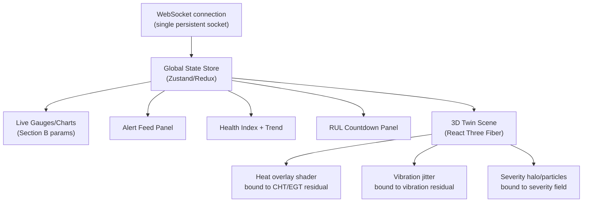

# workflow.md — AeroTwin Real-Time System Workflow

> Defines exactly how data moves through the system tick-by-tick, in both **Live Mode** and **Replay/What-If Mode**. Any implementation must match this spec — treat message schemas here as the API contract between backend and frontend.

---

## 1. High-Level Real-Time Loop

```mermaid
flowchart LR
    SIM["Synthetic Telemetry<br/>Generator (Python)"] -->|"raw packet<br/>every tick"| BUF["Ingestion Buffer<br/>(FastAPI intake)"]
    BUF --> PHYS["Physics Model<br/>predicts expected values"]
    PHYS --> RES["Residual Engine<br/>Actual − Predicted"]
    RES --> ML["ML Layer<br/>Anomaly → Fault Class → RUL"]
    ML --> XAI["Explainability<br/>top contributing residuals"]
    XAI --> ROUTE{"Severity Router"}
    ROUTE -->|Normal| STORE["Persist tick<br/>(DB / mission log)"]
    ROUTE -->|Anomaly/Fault| STORE
    STORE --> WS["WebSocket Broadcast<br/>to connected clients"]
    WS --> FE["React Frontend<br/>Dashboard + 3D Twin"]
```



**Tick rate target:** 5–10 Hz for demo purposes (configurable). Each tick must complete physics prediction + residual + ML inference well within the tick interval (e.g., under 100ms at 10Hz) to remain "real-time."

---

## 2. Live Mode — Step-by-Step

1. **Simulator** emits a raw telemetry packet at the configured tick rate (includes injected fault state if active)
2. **Backend intake** timestamps and validates the packet against the schema (Section 4)
3. **Physics model** runs with the same operating condition inputs (throttle, altitude, ambient temp) to produce the expected/predicted packet
4. **Residual engine** subtracts predicted from actual, per parameter, producing a residual vector
5. **ML layer** consumes the residual vector:
   - Anomaly detector scores the vector
   - If anomalous, fault classifier assigns a fault class + confidence
   - RUL model updates degradation trend and remaining-hours estimate
6. **Explainability layer** ranks which residual channels contributed most to the anomaly score
7. **Severity router** decides: Normal (log only) / Low (trend watch) / Medium (dashboard advisory) / High-Critical (real-time alert + mission risk flag)
8. **Persistence layer** stores the full tick (raw + predicted + residual + ML output + severity) for later replay
9. **WebSocket broadcast** pushes the enriched tick to all connected frontend clients
10. **Frontend** updates: live gauges, alert feed, health index, RUL countdown, and the 3D twin's visual state — all from the same broadcast message (no separate polling)

---

## 3. Replay / What-If Mode — Step-by-Step

**Replay:**
1. User selects a stored mission from the mission list (REST `GET /missions`)
2. Frontend requests the full tick sequence (REST `GET /missions/{id}/ticks`) or streams it paginated
3. A **replay controller** on the frontend feeds stored ticks into the *same* rendering pipeline used in Live Mode, at adjustable speed (0.5x–8x) or scrub-to-timestamp
4. Dashboard and 3D twin render identically to live mode — components must not know or care whether data is live or replayed

**What-If Simulation:**
1. User sets a scenario preset (High Altitude / Endurance / Hot-Weather / Rapid Throttle) or custom sliders (throttle profile, altitude, ambient temp)
2. Frontend sends config to `POST /simulate/whatif`
3. Backend runs the **physics model only** (no real/simulated sensor input — this is a pure forward simulation) across the specified time horizon
4. Backend returns the predicted engine behavior time series
5. Frontend renders this as a preview timeline + 3D twin animation, clearly labeled "Simulated Preview — Not Live Data"

---

## 4. Message Schemas (API Contract)

### 4.1 Raw Telemetry Packet (Simulator → Backend)
```json
{
  "timestamp": "2026-08-30T10:15:32.120Z",
  "mission_id": "sim-0001",
  "operating_condition": {
    "throttle_pct": 72,
    "altitude_m": 4200,
    "ambient_temp_c": 18
  },
  "sensors": {
    "rpm": 4850,
    "cht": 198,
    "egt": 690,
    "oil_pressure": 4.1,
    "oil_temp": 92,
    "fuel_flow": 11.3,
    "vibration": 0.42,
    "battery_voltage": 27.8,
    "injection_timing": 14.5
  },
  "injected_fault": null
}
```

### 4.2 Enriched Tick (Backend → Frontend, via WebSocket)
```json
{
  "timestamp": "2026-08-30T10:15:32.120Z",
  "mission_id": "sim-0001",
  "sensors": { "...same as above..." },
  "predicted": {
    "rpm": 4830, "cht": 190, "egt": 675, "oil_pressure": 4.2,
    "oil_temp": 89, "fuel_flow": 11.0, "vibration": 0.30,
    "battery_voltage": 27.9, "injection_timing": 14.4
  },
  "residual": {
    "rpm": 20, "cht": 8, "egt": 15, "oil_pressure": -0.1,
    "oil_temp": 3, "fuel_flow": 0.3, "vibration": 0.12,
    "battery_voltage": -0.1, "injection_timing": 0.1
  },
  "ml_output": {
    "anomaly_score": 0.73,
    "fault_class": "abnormal_vibration",
    "confidence": 0.81,
    "rul_hours": 6.5,
    "top_contributors": ["vibration", "egt"]
  },
  "severity": "medium",
  "health_index": 0.68
}
```

### 4.3 Alert Message (Backend → Frontend, on severity ≥ medium)
```json
{
  "alert_id": "alrt-8841",
  "timestamp": "2026-08-30T10:15:32.120Z",
  "severity": "high",
  "fault_class": "misfire",
  "message": "Misfire pattern detected — driven primarily by EGT and vibration residuals",
  "rul_hours": 2.1,
  "recommended_action": "Reduce throttle, schedule ground inspection of injector timing"
}
```

### 4.4 Mission Summary (REST, for reports)
```json
{
  "mission_id": "sim-0001",
  "duration_min": 42,
  "avg_health_index": 0.81,
  "faults_detected": ["sensor_drift"],
  "min_rul_hours": 11.2,
  "recommendation": "No immediate maintenance required; monitor sensor drift on next flight"
}
```

---

## 5. Frontend Real-Time State Flow



**Rule:** All visual components subscribe to the same global store slice — never fetch independently. This keeps Live and Replay modes visually identical since both simply populate the same store.

---

## 6. Latency & Performance Budget (Demo Target)

| Stage | Budget |
|---|---|
| Simulator tick generation | < 5 ms |
| Physics prediction | < 20 ms |
| Residual computation | < 5 ms |
| ML inference (anomaly + classification + RUL) | < 50 ms |
| WebSocket broadcast + frontend render | < 30 ms |
| **Total tick-to-screen latency** | **< 150 ms** (comfortably real-time at 5–10Hz) |

---

## 7. Failure & Fallback Handling

- If ML inference fails/times out for a tick → forward raw + residual only, mark `ml_output: null`, frontend shows "analysis pending" instead of crashing
- If WebSocket disconnects → frontend auto-reconnects and requests the last N ticks via REST to backfill the gap
- If physics model receives an out-of-range operating condition (e.g., altitude beyond model validity) → clamp to nearest valid range and flag `"model_extrapolated": true` in the packet so this is never silently trusted as precise
